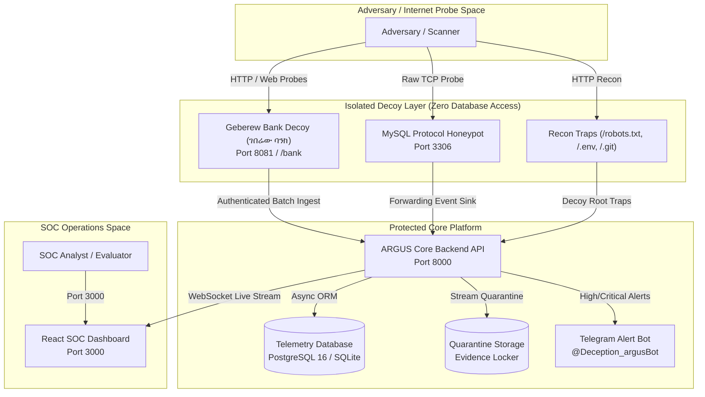

# ARGUS: Cyber Deception & Attack-Monitoring System

[](LICENSE)
[](https://www.python.org/downloads/)
[](https://reactjs.org/)
[](https://fastapi.tiangolo.com)
[](https://www.docker.com/)
[]()

---

## 🎓 INSA Cyber Talent Center (CTC) — Project Submission Metadata

| Requirement | Project Submission Details |
|---|---|
| **Project Title** | **ARGUS: Cyber Deception & Attack-Monitoring System** |
| **GitHub Repository** | `https://github.com/aprotovic/argus-deception-platform` |
| **Team Members** | • **Goitom Shumey Gebremariam** (Team Lead / Backend)<br>• **Muaz Muhammed** (Frontend / Decoy UI)<br>• **Zyad** (Security Engineer / Forensics)<br>• **Bereket Worana** (Cyber Deception / Security Analyst) |
| **Video Presentation** | • Full HD (1080p) Video: [`output/argus_presentation_demo.mp4`](output/argus_presentation_demo.mp4)<br>• Presentation Voice Script: [`docs/DEMO_VIDEO_VOICE_SCRIPT.md`](docs/DEMO_VIDEO_VOICE_SCRIPT.md) |
| **Evaluation Guide** | [`docs/MENTOR_GUIDE.md`](docs/MENTOR_GUIDE.md) |
| **Automated Verification** | **372 / 372 Passed (100%)** via `pytest` |

---

**ARGUS** is an enterprise-grade cyber deception and telemetry capture platform designed as a Software Engineering graduation capstone project. It deploys isolated decoy surfaces—including a realistic retail banking portal (**Geberew Bank — ገበሬው ባንክ**) and a low-interaction MySQL honeypot—to divert unauthorized actors away from production assets, capture tamper-evident security telemetry, quarantine uploaded malicious artifacts, and visualize genuine interaction metrics in a real-time Security Operations Center (SOC) dashboard.

---

## 🏛️ Key Capabilities

- **Realistic Banking Decoy Surface**: Convincing retail banking portal interface (**Geberew Bank — ገበሬው ባንክ**) built with React, TypeScript, and Tailwind CSS. Features dynamic 3D card tilt/flip, bilingual support (English / Ge'ez Amharic), simulated credential-stuffing traps, two-factor authentication (OTP) simulation, and diagnostic payload upload endpoints.
- **Raw Protocol Decoy (MySQL 3306)**: Asynchronous low-interaction TCP honeypot emulating the MySQL Server greeting and authentication handshake protocol, capturing rogue database discovery probes and SQL injection attempts.
- **Zero-Plaintext Credential Policy**: Attacker-submitted passwords are **never** stored in plaintext. ARGUS records password length and computes an HMAC-SHA256 fingerprint using a dedicated server-side secret key to identify coordinated credential-stuffing attacks safely.
- **Safe Payload Quarantine**: Submitted files are captured via streaming I/O, stored in a non-executable directory with UUIDv4 filenames, assigned verifiable SHA-256 hashes, and isolated from standard OS parsers.
- **Real-Time SOC Monitoring Dashboard**: Interactive React + TypeScript monitoring interface connected via WebSockets for real-time attack stream visualization, deep event inspection, evidence management, MITRE ATT&CK matrix mapping, GeoIP threat intelligence, and one-click data export (PDF, CSV, JSON).
- **Out-of-Band Telegram Threat Alerts**: Automated push dispatching of high-severity security incidents directly to a dedicated Telegram SOC Bot (`@Deception_argusBot`).
- **Hardened Architecture**: Full container isolation, unprivileged user execution, read-only root filesystems, strict network segmentation (the decoy has zero database credentials or ORM access), and comprehensive audit trails.

---

## 📐 Architectural Topology



---

## ⚡ Quickstart Guide

### Prerequisites
- **Python 3.11+**
- **Node.js 18+** and **npm**
- *(Optional)* **Docker & Docker Compose**

---

### Option 1: One-Click Local Launcher (Recommended for Evaluation)

You can launch all 4 ARGUS services simultaneously with a single command:

#### On Windows:
Double-click `start_argus.bat` or run:
```bash
python scripts\run_all.py
```

#### On Linux / macOS:
```bash
python scripts/run_all.py
```

This starts:
| Service | URL / Port | Description |
|---|---|---|
| **SOC Operations Dashboard** | [http://127.0.0.1:3000](http://127.0.0.1:3000) | Live incident monitoring & analytics |
| **Geberew Bank Decoy Portal** | [http://127.0.0.1:8081](http://127.0.0.1:8081) | Public decoy banking interface |
| **Core Ingestion Backend API** | [http://127.0.0.1:8000](http://127.0.0.1:8000) | Telemetry capture & Swagger docs (`/docs`) |
| **MySQL Protocol Honeypot** | `127.0.0.1:3306` | Emulated MySQL TCP listener |

---

### Option 2: Docker Compose (Production Stack)

```bash
cp .env.example .env
docker compose up --build
```

---

## 🔑 Default Credentials for Evaluation

### SOC Dashboard Operator Login
- **URL**: [http://127.0.0.1:3000](http://127.0.0.1:3000)
- **Username**: `argus_admin`
- **Password**: `ArgusAdmin2026!ChangeMe`

### Geberew Bank Decoy Bait Credentials
*(Use these on the decoy portal to observe realistic 2FA/OTP escalation)*
- **URL**: [http://127.0.0.1:8081/bank/login](http://127.0.0.1:8081/bank/login)
- **Bait Account 1**: `j.hartwell` / `Hartwell2024!`
- **Bait Account 2**: `m.chen` / `Chen@Banking1`
- **Any Other Input**: Recorded as simulated credential stuffing attempt.

### Telegram Live Alert Bot
- **Bot**: [@Deception_argusBot](https://t.me/Deception_argusBot)
- High and critical incidents automatically dispatch instant push notifications with MITRE classification, client IP, and threat severity.

---

## 🧪 Automated Attack Simulation

To immediately populate the SOC dashboard with simulated attacks (SQLi, scanner probes, credential stuffing, quarantine uploads, MySQL probes):

```bash
python scripts/simulate_traffic.py --count 16
```

Watch the live events stream into the dashboard in real time!

---

## 📚 Documentation Index

- 📋 [**Mentor Evaluation & Walkthrough Guide**](docs/MENTOR_GUIDE.md) *(Read this first for graduation assessment)*
- 🛡️ [Security Architecture & Threat Model](docs/SECURITY_ARCHITECTURE.md)
- 🗄️ [Relational Data Model](docs/DATA_MODEL.md)
- 🔌 [REST & WebSocket API Reference](docs/API.md)
- 🧪 [Testing & Validation Guide](docs/TESTING.md)
- 🚀 [Deployment & Operational Procedures](docs/DEPLOYMENT.md)
- 🛣️ [Known Limitations & Roadmap](docs/KNOWN_LIMITATIONS.md)

---

## 🧪 Test Suite Verification

Run the comprehensive unit and integration test suite:
```bash
pytest
```
*Result: 372/372 passing tests covering protocol compliance, rate limiting, zero-plaintext hashing, database isolation, and API routes.*

---

## 📄 License
Academic Graduation Capstone Project — MIT License
