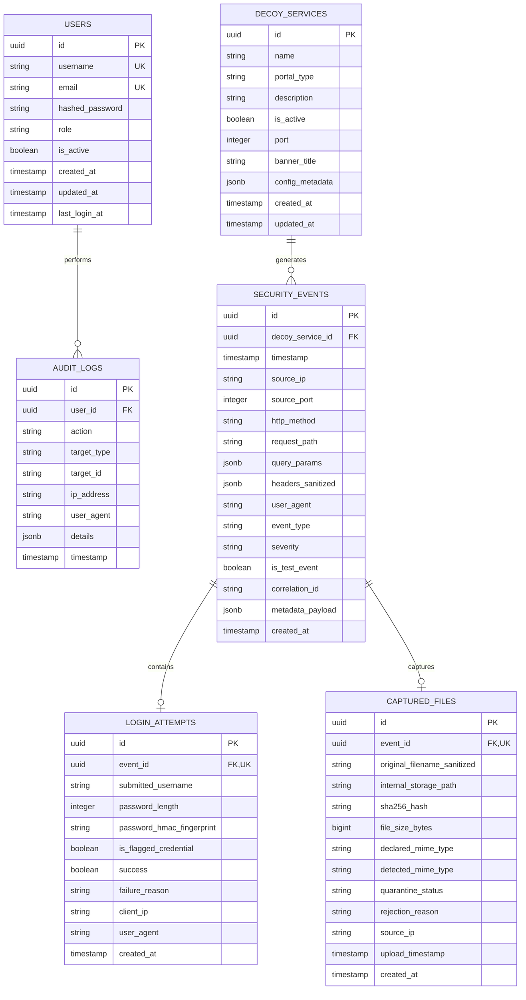

# ARGUS: Relational Data Model Specification

## 1. Overview
ARGUS utilizes a normalized PostgreSQL relational database schema managed via SQLAlchemy 2.0 (Async) and Alembic migrations. All timestamps are strictly stored in UTC (`TIMESTAMP WITH TIME ZONE`). UUIDv4 primary keys are utilized across security-sensitive tables to prevent sequential enumeration attacks.

---

## 2. Entity-Relationship Diagram (ERD)

---

## 3. Entity Definitions

### 3.1 `users`
Represents SOC analysts, administrators, and auditors authorized to monitor ARGUS.
- `id` (UUID, Primary Key, default `uuid4`)
- `username` (VARCHAR(64), Unique, Indexed)
- `email` (VARCHAR(255), Unique, Indexed)
- `hashed_password` (VARCHAR(255), Bcrypt hash)
- `role` (VARCHAR(32), Enum: `admin`, `analyst`, `auditor`, default `analyst`)
- `is_active` (BOOLEAN, default `true`)
- `created_at` (TIMESTAMPTZ, default UTC now)
- `updated_at` (TIMESTAMPTZ, default UTC now)
- `last_login_at` (TIMESTAMPTZ, nullable)

### 3.2 `decoy_services`
Tracks decoy configurations and honeypot profiles deployed across the organization.
- `id` (UUID, Primary Key)
- `name` (VARCHAR(100), e.g., "Nexis Defense Core Portal")
- `portal_type` (VARCHAR(50), e.g., `defense_contractor_portal`)
- `description` (TEXT)
- `is_active` (BOOLEAN, default `true`)
- `port` (INTEGER, e.g., 8080)
- `banner_title` (VARCHAR(255))
- `config_metadata` (JSONB, default `{}`)
- `created_at` / `updated_at` (TIMESTAMPTZ)

### 3.3 `security_events`
The central immutable security telemetry record for every interaction captured by the decoy.
- `id` (UUID, Primary Key, indexed)
- `decoy_service_id` (UUID, Foreign Key to `decoy_services.id`, nullable)
- `timestamp` (TIMESTAMPTZ, indexed, UTC time when interaction occurred)
- `source_ip` (VARCHAR(45), indexed, IPv4 or IPv6)
- `source_port` (INTEGER, nullable)
- `http_method` (VARCHAR(10), e.g., `POST`, `GET`)
- `request_path` (VARCHAR(1024), indexed, e.g., `/login`, `/portal/support/upload`, `/.env`)
- `query_params` (JSONB)
- `headers_sanitized` (JSONB, cookies/tokens removed)
- `user_agent` (TEXT, indexed)
- `event_type` (VARCHAR(50), indexed, Enum: `login_attempt`, `file_upload`, `recon_probe`, `unauthorized_access`, `malformed_request`)
- `severity` (VARCHAR(20), indexed, Enum: `low`, `medium`, `high`, `critical`)
- `is_test_event` (BOOLEAN, indexed, default `false`, enables clean separation of test vs real attacks)
- `correlation_id` (VARCHAR(64), indexed, links multi-step actions from same session)
- `metadata_payload` (JSONB, extensible event metadata)
- `created_at` (TIMESTAMPTZ, default UTC now)

### 3.4 `login_attempts`
Decoy-specific credential capture record. Plaintext passwords are never retained.
- `id` (UUID, Primary Key)
- `event_id` (UUID, Foreign Key to `security_events.id`, Unique, Indexed)
- `submitted_username` (VARCHAR(255), indexed)
- `password_length` (INTEGER)
- `password_hmac_fingerprint` (VARCHAR(64), HMAC-SHA256 of submitted password using server key)
- `is_flagged_credential` (BOOLEAN, default `false`)
- `success` (BOOLEAN, default `false`, decoys never grant real access)
- `failure_reason` (VARCHAR(100), e.g., `invalid_credentials_simulated`)
- `client_ip` (VARCHAR(45))
- `user_agent` (TEXT)
- `created_at` (TIMESTAMPTZ)

### 3.5 `captured_files`
Secure quarantine inventory for files submitted to the decoy upload interface.
- `id` (UUID, Primary Key)
- `event_id` (UUID, Foreign Key to `security_events.id`, Unique, Indexed)
- `original_filename_sanitized` (VARCHAR(255))
- `internal_storage_path` (VARCHAR(512), isolated file path on disk)
- `sha256_hash` (CHAR(64), indexed, verifiable cryptographic checksum)
- `file_size_bytes` (BIGINT)
- `declared_mime_type` (VARCHAR(100))
- `detected_mime_type` (VARCHAR(100))
- `quarantine_status` (VARCHAR(30), Enum: `quarantined`, `analyzed`, `archived`, `rejected`)
- `rejection_reason` (VARCHAR(255), nullable)
- `source_ip` (VARCHAR(45), indexed)
- `upload_timestamp` (TIMESTAMPTZ)
- `created_at` (TIMESTAMPTZ)

### 3.6 `audit_logs`
Tamper-evident log of administrative dashboard activities.
- `id` (UUID, Primary Key)
- `user_id` (UUID, Foreign Key to `users.id`, nullable)
- `action` (VARCHAR(100), e.g., `EVIDENCE_DOWNLOAD`, `EVENT_EXPORT`, `AUTH_LOGIN`)
- `target_type` (VARCHAR(50), e.g., `captured_file`, `security_event`)
- `target_id` (VARCHAR(64), target identifier)
- `ip_address` (VARCHAR(45))
- `user_agent` (TEXT)
- `details` (JSONB)
- `timestamp` (TIMESTAMPTZ, default UTC now, indexed)
