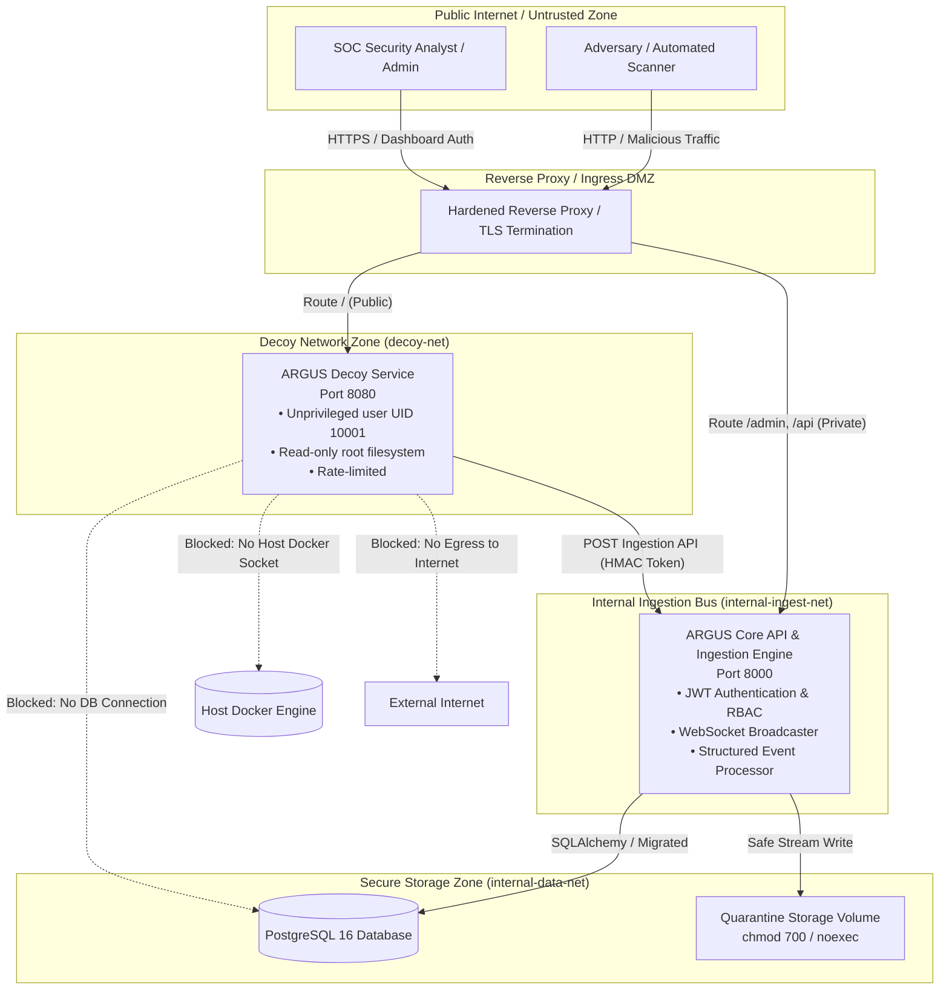

# ARGUS: Security Architecture & Threat Model

## 1. System Overview & Mission Statement
ARGUS is an internet-facing cyber deception platform engineered to safely entice, capture, and inspect unauthorized interactions. Because the system is intentionally deployed to receive malicious traffic, **containment, isolation, and safe handling** are core architectural constraints. Under no circumstance may an interaction with the decoy compromise the host, expose internal networks, execute untrusted user code, or inadvertently leak genuine credentials.

---

## 2. Threat Model (STRIDE Assessment)

| Threat Category | Specific Risk Scenario | ARGUS Architectural Mitigation |
| :--- | :--- | :--- |
| **Spoofing** | Attacker impersonates an internal operator to access the evidence locker or tamper with logs. | Dashboard requires strong JWT authentication with bcrypt/argon2 hashing, RBAC enforcement (`admin`, `analyst`, `auditor`), and unforgeable audit logging. Decoy service cannot authenticate or access dashboard APIs. |
| **Tampering** | Attacker alters captured security events, audit trails, or modifies quarantined files. | Decoy container has no write access to the database or admin filesystem. Quarantined files are assigned immutable SHA-256 hashes upon arrival and stored in non-executable, read-only-after-write storage. |
| **Repudiation** | An analyst downloads captured malware or alters logs and denies doing so. | Append-only `audit_logs` table records every administrative action (logins, evidence views, downloads, exports) with user ID, IP address, timestamp, and target hash. |
| **Information Disclosure** | Decoy inadvertently stores plaintext attacker-submitted passwords (which could match legitimate corporate passwords), or exposes sensitive server configuration in stack traces. | Password values are **never** stored in plaintext. ARGUS records password length and computes an HMAC-SHA256 fingerprint using an isolated server-side secret key (`ARGUS_PASSWORD_FINGERPRINT_SECRET`). HTTP response headers are sanitized; stack traces and server banners are suppressed. |
| **Denial of Service (DoS)** | Mass probe floods, zip bombs, or multi-gigabyte upload floods exhaust disk, CPU, or memory. | Configurable request size limits (10 MB upload cap), streaming hashing without buffering in RAM, per-IP rate limiting, and Docker Compose resource limits (`cpus: "1.0"`, `memory: 512M`). |
| **Elevation of Privilege** | Attacker uploads a web shell or exploit payload and attempts remote code execution (RCE) via path traversal or direct execution. | Quarantined files are saved using a randomly generated UUIDv4 filename with `.quarantine` extension in an unmounted web directory with `noexec` flags. The decoy application never invokes parsers, system shells, or execution tools on captured files. Containers run as non-root unprivileged users (`UID 10001`). Docker socket is never mounted. |

---

## 3. Network Architecture & Trust Boundaries

The system is partitioned into three distinct network zones with strict egress and ingress controls:

---

## 4. Security Controls & Implementations

### 4.1 Container Isolation & Hardening
1. **Unprivileged Execution**: All services run as a dedicated non-root user (`argus:argus`, UID 10001, GID 10001).
2. **Filesystem Isolation**: Root filesystem mounted as `read-only` where applicable, with ephemeral `/tmp` mounted via `tmpfs`.
3. **No Docker Socket Mounting**: The host's `/var/run/docker.sock` is strictly forbidden in all container configurations.
4. **Resource Constraints**:
   - Decoy service: CPU limit `1.0`, memory limit `512MB`, max open file descriptors `1024`.
   - Core API: CPU limit `1.5`, memory limit `1GB`.
   - PostgreSQL: memory limit `1GB`.
5. **Egress Restrictions**: The decoy container is prohibited from making arbitrary outbound network requests, preventing attackers from using the decoy as an open proxy or pivot point.

### 4.2 Decoy Telemetry & Password Redaction
1. **Zero Plaintext Credentials**:
   - `password_length`: Integer reflecting character count.
   - `password_fingerprint`: Keyed HMAC-SHA256 hash using `ARGUS_PASSWORD_FINGERPRINT_SECRET`. Allows analysts to group credential stuffing campaigns while preventing credential exposure.
2. **Sanitized Header Ingestion**:
   - Sensitive headers (`Authorization`, `Cookie`, `X-Auth-Token`) are redacted or stripped from event metadata.
   - Safe analytical headers (`User-Agent`, `Accept`, `Accept-Language`, `Referer`, `Sec-Ch-Ua`) are preserved.
3. **True Source IP Preservation**:
   - Ingress proxy passes original client IP via `X-Forwarded-For`.
   - Backend only trusts `X-Forwarded-For` from configured, trusted upstream proxies to prevent header spoofing.

### 4.3 Controlled Payload Quarantine
1. **Randomized Internal Filenames**: Every uploaded artifact is renamed to a UUIDv4 string (e.g., `550e8400-e29b-41d4-a716-446655440000.quarantine`). The user-supplied filename is never used as an operating system filesystem path.
2. **Path Traversal Defenses**: Filenames are strictly sanitized with `os.path.basename` and stripped of null bytes (`\0`), directory delimiters (`/`, `\`), and relative path tokens (`..`).
3. **Streaming Cryptographic Hashing**: SHA-256 hash is calculated in 64 KB memory chunks during the ingestion stream. Files exceeding size limits (10 MB) are immediately terminated and deleted.
4. **Non-Execution Invariant**:
   - Quarantined files are saved with permissions `0600` (read/write only by the backend service user, never execute).
   - Captured files are never passed to standard parsers (e.g., no ImageMagick, PDF renderers, zip unpackers, or script evaluators).
5. **Authenticated Evidence Custody**:
   - Only users with the `admin` role can request evidence file downloads.
   - Every file download triggers an immutable entry in the `audit_logs` table.

### 4.4 Dashboard Security & RBAC
1. **Roles**:
   - `admin`: Full system access, evidence download, user management, export.
   - `analyst`: Read-only telemetry access, search, filtering, CSV/JSON export.
   - `auditor`: Access to administrative audit logs and metrics.
2. **Session Security**: JWT tokens signed with SHA-256 HMAC or RSA-256, short lifespan (60 minutes), with secure refresh token rotation.
3. **CORS & Headers**: Strict CORS origin validation, `Content-Security-Policy`, `X-Content-Type-Options: nosniff`, `X-Frame-Options: DENY`, `Strict-Transport-Security`.
